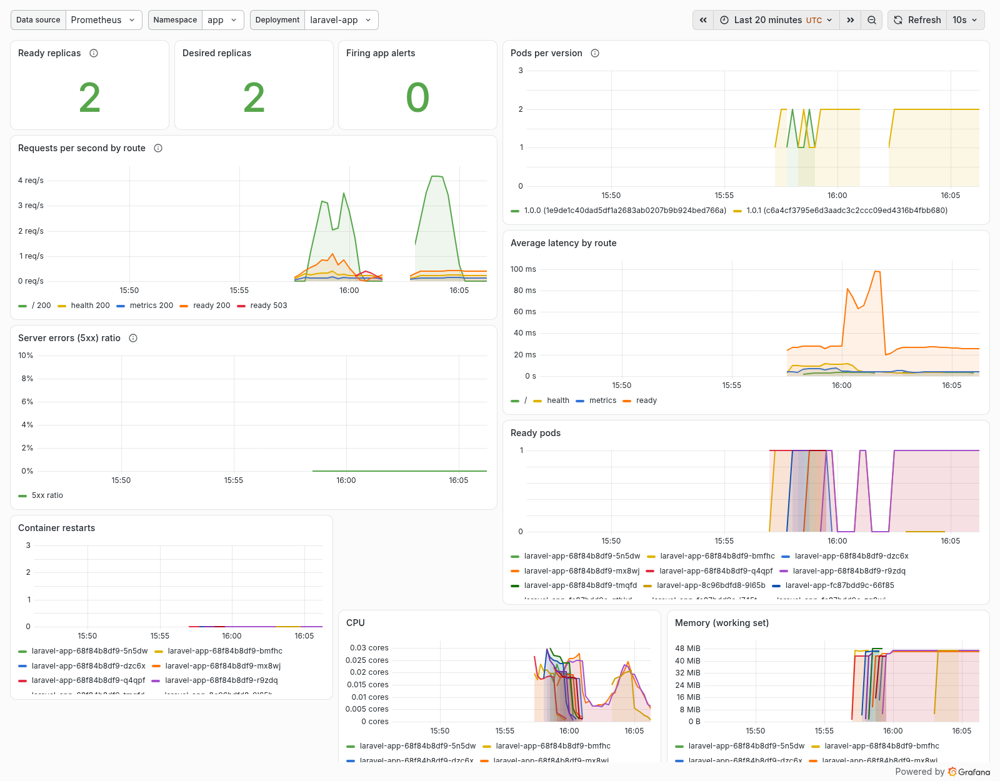
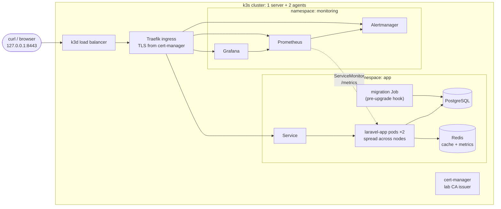

# k3s-platform-lab

[](https://github.com/erfan-zamanzade/k3s-platform-lab/actions/workflows/ci.yml)

A local Kubernetes platform that deploys, monitors and deliberately breaks a containerised Laravel service, and checks that it recovers.

It takes the image built and scanned by [laravel-cicd-pipeline](https://github.com/erfan-zamanzade/laravel-cicd-pipeline) and runs it on k3s (via k3d) with a Helm chart, TLS ingress, network policies, Prometheus, Grafana and Alertmanager. Scripts drive rolling updates, rollbacks and failure drills under live traffic, and the whole sequence runs on every push in GitHub Actions on a throwaway cluster.



*The provisioned dashboard after a full local run: the 1.0.0 → 1.0.1 rolling update, rollback and roll-forward (Pods per version), the PostgreSQL and Redis outages (Ready pods dropping to zero, `/ready` latency rising), and zero container restarts throughout.*

## What it demonstrates

| Area | How |
|------|-----|
| Helm chart | Deployment, Service, Ingress, PodDisruptionBudget, NetworkPolicy, ServiceMonitor, PrometheusRule, Grafana dashboard, migration Job, `helm test`; 17 helm-unittest cases |
| Health model | Liveness on `/health` (process only), readiness on `/ready` (PostgreSQL + Redis), startup probe for cold starts |
| Zero-downtime rollouts | `maxUnavailable: 0`, `minReadySeconds`, a `preStop` sleep so the ingress stops routing before the pod stops; verified with a client sending requests during every update |
| Safe releases | Migrations run once as a pre-upgrade hook; a broken release stalls instead of replacing healthy pods; `helm rollback` restores the last good revision |
| TLS | cert-manager with a private lab CA; every client check verifies the certificate (no `-k`) |
| Network policy | The app only accepts traffic from the ingress controller, Prometheus and its own test pod; the databases only from labelled clients. Tested both ways |
| Monitoring | kube-prometheus-stack, a ServiceMonitor for the app, recording rules, four alerts with promtool unit tests, and a provisioned Grafana dashboard |
| Failure drills | Pod loss, PostgreSQL outage, Redis outage, bad configuration release. Each asserts what clients saw, what Kubernetes did and which alert fired |
| CI | Static checks (helm lint, unit tests, kubeconform, shellcheck, promtool, actionlint) then a full end-to-end run on a k3d cluster in GitHub Actions |
| Reproducibility | Every tool, chart and image is pinned; downloads are verified against pinned SHA-256 checksums |

## Architecture



Network policies: the app pods accept connections only from `kube-system` (Traefik), `monitoring` (Prometheus) and the chart's test pod. PostgreSQL and Redis accept connections only from pods labelled `db-client: "true"`, which the chart adds to the app and the migration job.

## Repository layout

```
charts/laravel-app/        Helm chart (templates, dashboard JSON, helm-unittest suites)
environments/lab/          values for the local cluster
environments/ci/           CI overrides (shorter alert delays)
platform/monitoring/       kube-prometheus-stack values
platform/cert-manager/     cert-manager values and the lab CA issuers
platform/datastores/       lab-only PostgreSQL and Redis with network policies
k3d/cluster.yaml           cluster definition
scripts/                   install, deploy, smoke test, rollout, drills, lint
tests/alerts/              promtool unit tests for the alert rules
```

## Run it

Prerequisites: Linux or macOS with Docker, about 6 GB of free memory, and free ports 8443 and 8088 on `127.0.0.1`. `make tools` downloads everything else into `.tools/`. Both amd64 and arm64 hosts work.

```bash
make up        # tools, cluster, monitoring + cert-manager, app, smoke test (about 4 minutes once images are cached)
make rollout   # rolling update 1.0.0 -> 1.0.1 and rollback under traffic
make drills    # all failure drills
make down      # delete the cluster
```

The scripts never touch your own kubeconfig: the lab writes its own to `.kube/config` and every script refuses to run unless the current context is the lab cluster. To use `kubectl` yourself:

```bash
export KUBECONFIG=$PWD/.kube/config PATH=$PWD/.tools/bin:$PATH
```

### Open the UIs

Services are published as `<name>.lab.test` on port 8443. Either add them to `/etc/hosts`:

```
127.0.0.1 app.lab.test grafana.lab.test prometheus.lab.test alertmanager.lab.test
```

or let curl resolve them:

```bash
curl --cacert .kube/lab-ca.crt --resolve app.lab.test:8443:127.0.0.1 https://app.lab.test:8443/ready
```

Browsers will warn about the certificate unless you import `.kube/lab-ca.crt`. Grafana's admin password is generated per cluster:

```bash
kubectl -n monitoring get secret grafana-admin -o jsonpath='{.data.admin-password}' | base64 -d
```

## Design decisions in the chart

- **Liveness and readiness check different things.** `/health` only proves PHP answers; `/ready` checks PostgreSQL and Redis. A database outage takes pods out of the load balancer but never restarts them, so they come back the moment the database does.
- **Rollouts never reduce capacity.** `maxSurge: 1, maxUnavailable: 0` plus a PodDisruptionBudget. The `preStop` sleep (native `sleep` lifecycle handler, no shell needed) keeps an old pod serving while Traefik notices it is gone.
- **Migrations run once, before the new pods.** A Helm `pre-install,pre-upgrade` Job instead of running `migrate` in every container start; a failing migration fails the release before anything is replaced.
- **No secrets in values or release history.** The chart reads database credentials from an existing Secret; the deploy script generates one with a random password per cluster.
- **Images can be pinned by digest.** `image.digest` wins over `image.tag`, so the exact scanned and attested image is deployed.
- **Metrics are deduplicated, not summed.** The app keeps request counters in Redis, so every replica reports the same totals. Recording rules take the `max` across pods; summing would multiply traffic by the replica count. A promtool test locks this in.
- **Probe traffic is not user traffic.** The 5xx alert ignores `/health`, `/ready` and `/metrics`, otherwise every failed readiness probe during an outage would count as a user-facing error.

## Alerts

| Alert | Fires when | Severity |
|-------|------------|----------|
| `LaravelAppDown` | No pod can be scraped (or no targets exist) | critical |
| `LaravelAppNoReadyReplicas` | Every pod fails readiness, so the service gets no traffic | critical |
| `LaravelAppDegraded` | Fewer ready replicas than desired for 5 minutes (stuck rollout, failing node) | warning |
| `LaravelAppHighErrorRate` | More than 5% of non-probe requests return 5xx for 5 minutes | critical |

Thresholds and delays are chart values. [`tests/alerts/laravel-app.test.yaml`](tests/alerts/laravel-app.test.yaml) has eight promtool test groups covering firing, not firing, labels and annotations. In the lab, Alertmanager has no external receiver; alerts are checked through its API.

## Failure drills

| Drill | What it does | Asserted outcome |
|-------|--------------|------------------|
| [`pod-loss.sh`](scripts/drills/pod-loss.sh) | Deletes an app pod while a client sends 5 requests per second | 0 failed requests; replacement pod Ready |
| [`dependency-outage.sh postgres`](scripts/drills/dependency-outage.sh) | Scales PostgreSQL to zero, then back | Pods NotReady, ingress answers 503, `LaravelAppNoReadyReplicas` fires in Prometheus and reaches Alertmanager, no container restarts, automatic recovery, alert resolves |
| [`dependency-outage.sh redis`](scripts/drills/dependency-outage.sh) | Same for Redis | Same outcome |
| [`bad-release.sh`](scripts/drills/bad-release.sh) | Upgrades with a wrong Redis host | Helm marks the release failed, healthy pods keep serving, `helm rollback` restores service, 0 failed requests throughout |
| [`rollout.sh`](scripts/rollout.sh) | 1.0.0 → 1.0.1 → rollback → 1.0.1 under traffic | 0 failed requests in each step |

A "slow responses" drill is not included: the demo service has no slow code path to degrade, and faking one would test the fake.

## What the lab found

These came out of building and running the drills, and are kept because they are the point of doing drills:

1. **A Redis outage would have restarted every pod.** The Redis outage drill showed that application `1.0.0` answered every request, including `/health`, with HTTP 500 when Redis was unreachable: its metrics store connected to Redis while being constructed, before the error handling that protects requests from metrics failures. Liveness would fail and Kubernetes would restart all pods for a cache outage. Fixed in [`1.0.1`](https://github.com/erfan-zamanzade/laravel-cicd-pipeline) (lazy connection, a feature test and a Redis drill in that repository's smoke test). The lab now upgrades from 1.0.0 to 1.0.1 in its rollout demo.
2. **An alert without labels.** The first `LaravelAppDown` expression (`absent(up == 1)`) produced an alert with no `namespace` or `job` label, which breaks routing and the dashboard's alert counter. The promtool test caught it; the rule now keeps both labels.
3. **Readiness checks can hang, not just fail.** Right after PostgreSQL disappears, connections to its old address hang instead of being refused, so `/ready` takes as long as the client allows. The 3-second probe timeout bounds this; the drill waits for the ingress to return 503 rather than expecting it immediately.
4. **Network policy is not instant for new pods.** A brand-new pod's first connections can be refused before the policy controller has synced its IP, which made a network policy test flaky. The test now retries for 20 seconds in both the allowed and the denied case.

## CI

[`.github/workflows/ci.yml`](.github/workflows/ci.yml), on every push and pull request:

| Job | Steps |
|-----|-------|
| Static checks | install pinned tools, `helm lint --strict`, helm-unittest, kubeconform (Kubernetes 1.37 schemas plus CRD schemas for cert-manager and Prometheus Operator kinds), shellcheck, promtool rule check and unit tests, actionlint |
| End to end | k3d cluster → platform → deploy → smoke test → rollout and rollback → four drills; diagnostics uploaded on failure; cluster always deleted |

The CI run uses shorter alert `for:` durations (`environments/ci/values.yaml`) so alerts fire within a minute; everything else is identical to the local lab.

## Security considerations

- App pods: non-root (uid 82), `allowPrivilegeEscalation: false`, all capabilities dropped, `RuntimeDefault` seccomp, no service account token.
- Not `readOnlyRootFilesystem`: the base image's init system (s6-overlay) must own `/run` and renders the Nginx configuration at start-up. Tested with Docker before deciding; documented instead of worked around.
- Database and Grafana passwords are generated per cluster, stored only in Secrets, never in values, Git or Helm release data.
- Network policies restrict both the app and the databases (see above).
- Everything is published on `127.0.0.1` only.
- Tools and images are pinned; tool downloads are checksum-verified; workflow actions are pinned to commit SHAs with read-only default permissions.

## Cost and resources

$0. Everything runs locally or on GitHub-hosted runners for public repositories. The full lab uses about 3 GB of memory (measured with `docker stats`); a complete CI run takes about 10 minutes.

## Troubleshooting

| Symptom | Check |
|---------|-------|
| `kubectl context is '...', expected 'k3d-platform-lab'` | Run `make cluster`; the scripts only use `.kube/config` in this repository |
| Port 8443 or 8088 in use | `LAB_HTTPS_PORT=9443 LAB_HTTP_PORT=9088 make up` (set the same variables for later commands) |
| Certificate errors in curl | Pass `--cacert .kube/lab-ca.crt`; re-run `make platform` if the file is missing |
| `/ready` returns 503 | Its JSON body names the failing check; `kubectl -n app get pods` for PostgreSQL and Redis |
| A drill fails | `scripts/diagnostics.sh` writes nodes, events, pod descriptions, logs and Helm history to `diagnostics/` |

## Known limitations

- The lab's PostgreSQL is a single pod on k3s local-path storage with no backups: it exists to give the app a real dependency to lose. Production would use a managed database or an operator.
- Scheduler, controller-manager, etcd and kube-proxy metrics are not scraped: k3s runs them inside one process without the usual endpoints, so their default alerts are disabled.
- Alertmanager has no notification receiver; adding Slack, Telegram or email is a values change.
- Three nodes in Docker on one host: node failure is not simulated.

## Verification evidence

All results come from real runs.

| Check | Where | Result |
|-------|-------|--------|
| Full pipeline in GitHub Actions (amd64) | [Run 40908386118](https://github.com/erfan-zamanzade/k3s-platform-lab/actions/runs/40908386118) | Static checks and end-to-end job passed (end-to-end 9 min 43 s): rollout 102 requests and rollback 80 requests with 0 failed, pod loss 171 requests 0 failed, PostgreSQL and Redis outages alerted after 55 s and 61 s with no restarts, bad release 432 requests 0 failed |
| Cluster and platform from zero (`cluster-up` + `install-platform`) | arm64 Linux server, Docker 29.3, 2026-10-29 | Passed in 2 min 16 s |
| Deploy, smoke test, rollout and all four drills | same machine, fresh cluster | Passed in 8 min 22 s |
| Rolling update 1.0.0 → 1.0.1 under traffic | same run | 103 requests, 0 failed |
| Rollback to 1.0.0 under traffic | same run | 78 requests, 0 failed |
| Pod loss | same run | 157 requests, 0 failed; replacement Ready |
| PostgreSQL outage | same run | `LaravelAppNoReadyReplicas` firing and in Alertmanager 55 s after the outage started; no restarts; recovered and resolved |
| Redis outage | same run | Alert after 61 s; no restarts; recovered and resolved |
| Bad release (wrong Redis host) | same run | Release marked failed, 2 old pods kept serving, 403 requests 0 failed, rollback restored service |
| Redis outage against app 1.0.0 | Docker Compose smoke test of the published image | `/health` and `/ready` returned 500: the bug fixed in 1.0.1 ([release run](https://github.com/erfan-zamanzade/laravel-cicd-pipeline/actions/runs/40905804051)) |
| Static checks | `make check` | helm-unittest 17/17, promtool 8 test groups, kubeconform 19/19 resources valid, shellcheck clean |
| Workflow lint | actionlint 1.7.12, zizmor 1.31.1 | No findings |

## Future improvements

- Argo CD to deploy from Git instead of scripts.
- Loki for logs next to the metrics.
- Horizontal Pod Autoscaler driven by request rate.
- Admission policy (Kyverno) that only admits images with a valid build provenance attestation.
